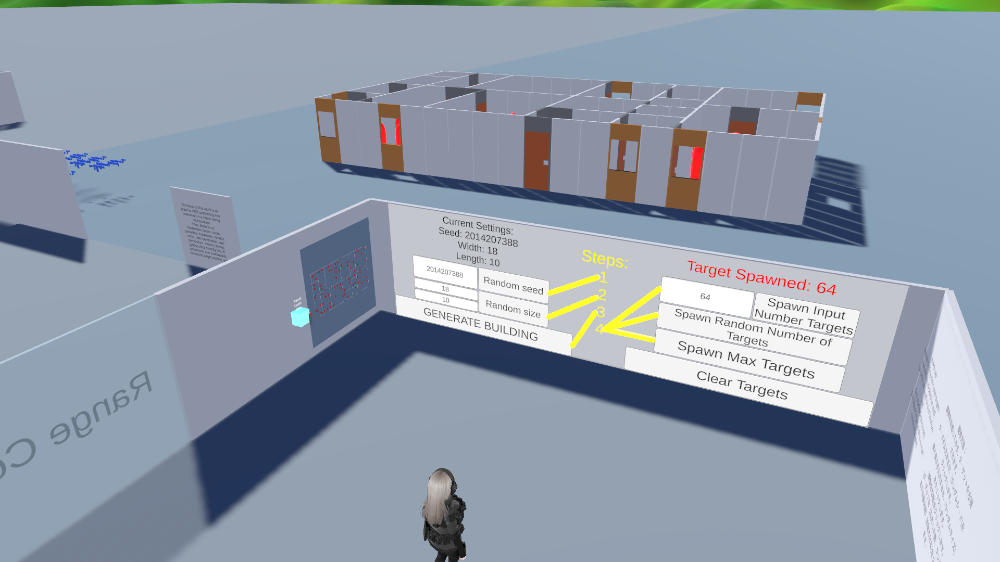
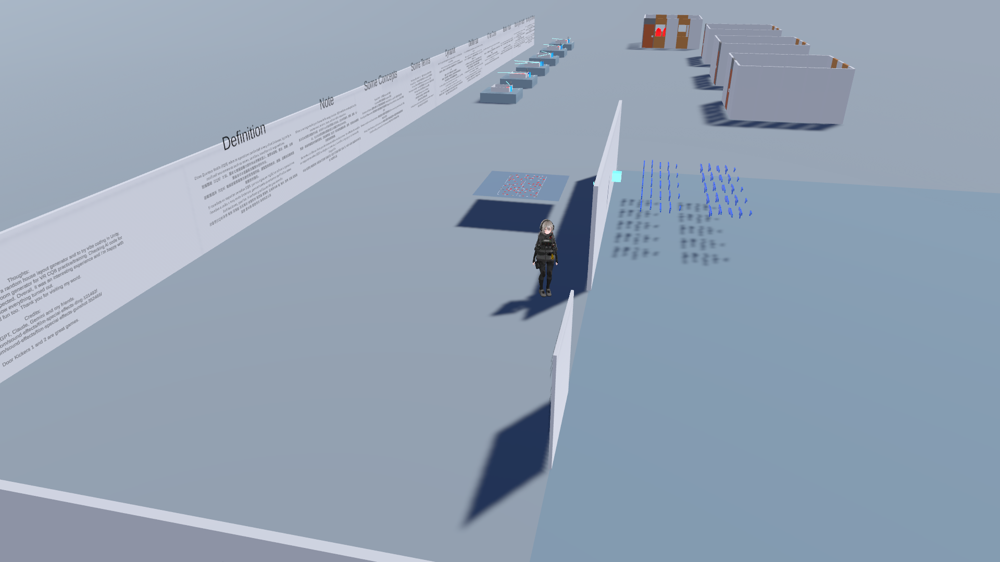
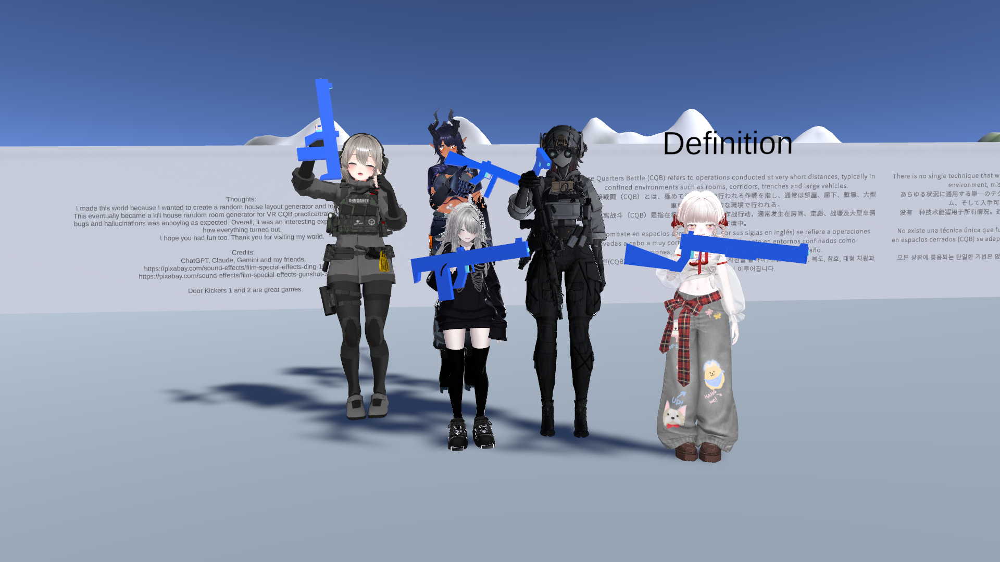

# CQB Kill House Generator

A procedural room generation system for VRChat, allowing players to create randomized Close Quarters Battle (CQB) training environments.

Built with Unity and UdonSharp, this project features procedural room layouts, interactive gameplay elements, network-synchronized systems, and customizable generation settings.

---

## Screenshots


---

## Overview

CQB Kill House Generator is a VRChat world designed around the concept of randomized CQB training environments.

Instead of navigating the same fixed layout every time, players can generate new room configurations, creating different layouts and combat scenarios.

The project focuses on procedural generation, multiplayer synchronization, and interactive gameplay systems within the limitations of VRChat's Udon environment.

---

## Features

- **Procedural Room Generation** – Generate randomized room layouts using a Binary Space Partitioning (BSP) algorithm.
- **Customizable Generation Settings** – Configure Kill House by setting room size (width and length) and seed.
- **Interactive Firearms** – Pick up and use weapons throughout the environment.
- **Target System** – Spawn and manage targets for shooting practice.
- **Multiplayer Synchronization** – Network-synchronized gameplay elements.
- **Interactive UI** – Configure and control generation settings through an in-world interface.
- **Reusable Object Systems** – Manage gameplay objects using predefined object pools where applicable.

---

## Procedural Generation

The room generation system uses **Binary Space Partitioning (BSP)** to divide a larger area into smaller sections.

These sections are used to determine room placement and layout, producing randomized CQB environments.

The generation process includes:

1. Initialize the generation area.
2. Recursively divide the area into smaller partitions.
3. Determine room placement within the partitions.
4. Create connections between rooms.
5. Generate the resulting room layout.

---

## How to play

Open this world in VRChat. https://vrchat.com/home/world/wrld_19a86643-2f9f-4601-98ad-2b24e23f81b5/info



1. Move to the right and enter Range Control Room.
2. Set size and seed.
3. Click generate to generate Kill House.
4. Click Spawn Targets.
5. Have fun!



---

## Gameplay Systems

### Firearms

Interactive firearms can be picked up and used by players.

### Targets

A target management system handles target activation, positioning, and network synchronization.

### Multiplayer

Gameplay systems are designed to support multiple players, with network ownership and synchronization handled through VRChat networking.

---

## Technical Details

| Component | Technology |
|---|---|
| Game Engine | Unity |
| Platform | VRChat |
| Scripting | UdonSharp / C# |
| Networking | VRChat Udon Networking |
| UI | Unity UI / TextMeshPro |
| Room Generation | Binary Space Partitioning (BSP) |

---

## Project Structure

<!-- Update this section to match the actual repository structure -->

```text
Assets/
├── Animation/
├── Materials/
├── Prefabs Guns/
├── Prefabs Other/
├── Prefabs Walls/
├── QvPen/
├── Scenes/
├── Scripts/
├── Sounds/
└── Terrain/
```

---

## Installation

1. Clone or download this repository.
2. Open the project using the compatible Unity version.
3. Ensure the required VRChat SDK and UdonSharp packages are installed.
4. Open the main world scene.
5. Build and test using the VRChat SDK.

Check the project configuration and package dependencies before opening the project.

---

## Configuration

Generation parameters can be adjusted through the exposed Unity Inspector settings.

Examples include:

- Maximum number of rooms.
- Minimum room dimensions.
- Generation parameters.
- Target count and gameplay settings.

---

## Possible Future Updates

- [ ] Further improve procedural room generation by improving BSP code.
- [ ] Add more door variations. Current door is 180 door. Left and right 90 doors types should be added.
- [ ] Rooms with double doors.
- [ ] Rooms with more door connections.
- [ ] Connect two rooms to form unique odd shape rooms.
- [ ] Code clean up and more code comments.

---

## Known Issues

<!-- Document known bugs, limitations, or compatibility issues -->

---

## Credits

Developed by Kasder [Kasderian]. Someone took the GitHub Username Kasder already. 

Built using Unity, UdonSharp, and the VRChat SDK.

My VRChat friends, thank you.

With the help of Claude, ChatGPT and Gemini.

[QvPen](https://booth.pm/ja/items/1555789)

[Ding Sound](https://pixabay.com/sound-effects/film-special-effects-ding-101492/)

[Gun Sound](https://pixabay.com/sound-effects/film-special-effects-gunshot-352466/)

---

## License

<!-- Specify your chosen license here -->
Credit me and use it as how you like. Please don't break any laws or any rules to Unity and VRChat.




